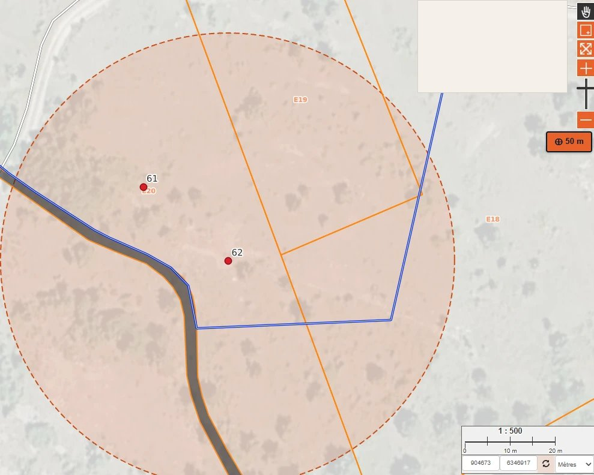

## Click buffer on map

* Add a button to enable a buffer mode: each click on the map draws a fixed-radius circle centered on the clicked point, replacing the previous one.
* Complements [Point buffer on map](../point_buffer_on_map), which centers the buffer on the map canvas instead of a clicked point.
* Contributed by [pierreflorin](https://github.com/pierreflorin).

