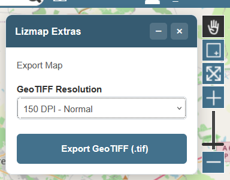

# GeoTIFF Export

Export the current map view as a georeferenced GeoTIFF (.tif) file.

## Features

- WYSIWYG georeferencing (uses OpenLayers 10 view, not the legacy OL2 map)
- DPI selection (150 / 200 / 300) for output resolution
- Detects CORS-tainted canvases (Google, OpenStreetMap basemaps) and warns the user gracefully

## Screenshot

## Usage

1. Copy `geotiff_export_3.9.js` to your Lizmap project's `media/js/` folder
2. Add it to the project's JavaScript configuration
3. A floating panel appears in the top-right corner of the map
4. Select the DPI and click "Export GeoTIFF"
5. Open the downloaded `.tif` file in QGIS or any GIS software

## Compatibility

- Lizmap Web Client **3.9.x** (OpenLayers 10)
- Tested with Firefox and Chrome

## Limitations

- Does **not** work with Google, OpenStreetMap, or other external basemaps that do not send CORS headers. The script detects this and shows a warning. Use a WMS basemap from your own QGIS Server instead.

## License

Mozilla Public License 2.0
