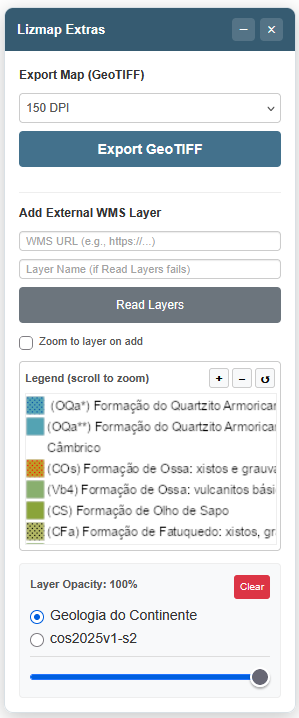

# Lizmap Extras: GeoTIFF Export & External WMS Loader

A floating panel with two tools for Lizmap Web Client 3.9+:

1. **Export Map as GeoTIFF** — WYSIWYG georeferenced export with DPI selection.
2. **Add External WMS Layer** — Load any WMS via GetCapabilities, with legend preview and opacity control.

## Features

### GeoTIFF Export
- WYSIWYG georeferencing using OpenLayers 10 (not the legacy OL2 map)
- DPI selection (150 / 200 / 300) for output resolution
- Detects CORS-tainted canvases and warns the user gracefully

### External WMS Loader
- Reads `<GetCapabilities>` from any WMS URL (GeoServer, MapServer, ArcGIS, QGIS Server)
- Displays available layers with their real `<Title>` names
- Fallback to manual layer name input when CORS blocks the XML read
- Reuses existing external groups (avoids duplicate name errors)
- Legend preview with zoom (buttons + mouse wheel + scroll)
- Per-layer opacity control with a multi-layer selector
- **Clear All** button to remove all external layers at once

## Screenshot

## Usage

1. Copy `lizmap_extras_3.9.js` to your Lizmap project's `media/js/` folder
2. Add it to the project's JavaScript configuration
3. A floating panel appears in the top-right corner
4. Use the GeoTIFF section to export the current view, or the WMS section to add external layers

## Compatibility

- Lizmap Web Client **3.9.x** (OpenLayers 10)
- Tested with Firefox and Chrome
- Compatible with GeoServer, MapServer, ArcGIS Server, and QGIS Server

## Known Limitations

- **CORS**: Exporting GeoTIFF is not possible when the map includes layers from servers that don't send CORS headers (e.g., Google, OpenStreetMap, Bing, or external WMS servers without CORS). The script detects this and shows a clear warning.
- External layer legends are displayed in the panel, not in the Lizmap TreeView (the API doesn't support injecting legends into the sidebar for external layers).

## Technical Note

Lizmap 3.9 exposes two OpenLayers instances:
- `lizMap.map` — **legacy OL2**, with incorrect `getSize()` and `getExtent()` for modern rendering
- `lizMap.mainLizmap.map` — **the real OL10 map** used for rendering

This script uses the OL10 instance for georeferencing and captures the `.ol-viewport canvas`.

## Future Improvements

- Multi-selection of WMS layers via checkboxes
- Persistence of external layers and opacity via `localStorage`
- Inclusion of the legend inside the exported GeoTIFF

## License

Mozilla Public License 2.0
