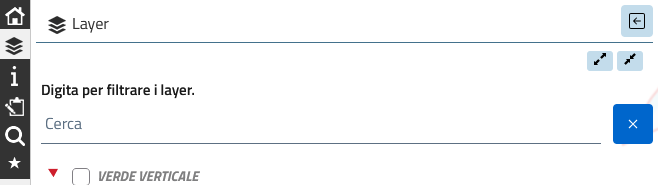

# Legend layer filter

Adds a search field above the legend to filter the layers by their title.

* Shows the layers whose title contains the typed text, and the groups containing them.
* If the text matches a group name, the whole content of the group is shown.
* The filter is case-insensitive and kept when groups are expanded or collapsed.
* A button clears the filter.
* Colors follow the Lizmap theme variables (`--color-contrasted-elements`, ...).
* The texts (label, placeholder, button) are defined at the top of the script and can be translated.

Available for Lizmap Web Client:
* 3.9 (tested with 3.9.12)
